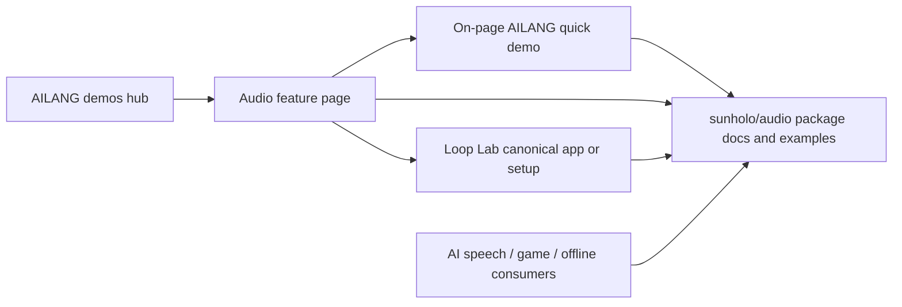

# AILANG audio showcase: Loop Lab as the main demo

Status: sprint implementation in progress, 2026-10-26. Native processing, UI and
build/integration are implemented; actual released-WASM/browser acceptance is
blocked on upstream loader defects. See [sprint plan](SPRINT_PLAN.md) and
[validation](VALIDATION.md). No public deployment has occurred. **Loop Lab is the primary interactive
audio application.** The demos page also includes a small, working audio demo
so visitors can try AILANG audio in the same place as the other demos. A full
processing workbench remains optional follow-up work.

## Outcome

Add an audio card to the demos hub and a small feature page at
`/ailang-demos/audio-tools/`. Show what visitors can do with Loop Lab, explain
which reusable AILANG package features support it, and let visitors make/process/
play a short sound directly on the page. Link onward to Loop Lab: source/setup
now, a public playable app when that deployment exists. The on-page demo must
work independently of Loop Lab hosting.

Keep one maintained Loop Lab application in
[sunholo-data/ailang-loop-lab](https://github.com/sunholo-data/ailang-loop-lab).
Its repo owns instrument behavior, capture, worker/worklet code, musical timing,
project features and deployment. Do not copy the application into ailang-demos.
The generic package continues to serve game, speech, AI-output and offline uses.

## Current release and hosting status

Verified 2026-10-26 through GitHub and the checked-in source:

| Component | Status | Meaning |
|---|---|---|
| `sunholo/audio@0.4.0` | Merged and AILANG-registry published | Generic delay/gain automation and earlier checked processing APIs are available to consumers |
| Loop Lab repo | Public | Anyone can read/clone the source |
| [Loop Lab v0.2.0](https://github.com/sunholo-data/ailang-loop-lab/releases/tag/v0.2.0) | GitHub source release | Runnable locally with its documented AILANG/Python setup; not an AILANG registry package |
| Loop Lab dependency | Exact registry `sunholo/audio@0.3.0` | The source release has not yet adopted audio 0.4.0 |
| Loop Lab CI | Verification workflow exists and has passed | CI success does not deploy an application |
| Public playable Loop Lab | Not deployed through the repo | No configured GitHub Pages site, homepage URL or recorded deployment; source uses the local Python/AILANG planner API |
| Private preview | Development-only | A Tailscale/local address is not a public “Play” destination |

Distinguish **public source**, **source release**, **registry package publication**
and **public app deployment** in UI copy and release notes. A “Play Loop Lab”
button must not point at a repo, localhost or private preview while suggesting an
immediately playable website.

## First delivery: working quick demo, highlights and link

This can ship before a browser-only port or hosted backend.

1. Add **Audio · Loop Lab** to `site/index.html`, using existing Sunholo/AILANG
   branding and navigation. Describe it as a four-part loop instrument prototype.
2. Link the card to `/audio-tools/` relative to the deployed demos root. The page
   contains the working quick demo below, a small set of Loop Lab feature
   highlights, and links to the public repo, source release and local setup.
3. Primary on-page action: **Make a sound**, then **Play original / Play processed**.
   The separate Loop Lab call to action is **Run Loop Lab locally** → repo setup
   guide, with **View source release** and **Explore the audio package** links.
4. Show a factual status label: **Open source · local setup required**. When a
   public app exists, change the primary action to **Play Loop Lab** using its
   canonical HTTPS URL; keep source/setup links available.
5. Explain the broader processing package with concise examples/source links.
   Do not build a second instrument or JavaScript-only DSP simulation for the card.

Browsing the page requires no microphone permission or API key. The quick demo
runs real AILANG in a worker, not a prerecorded playback or JavaScript DSP stand-in.
It is a compact package example alongside the main application showcase.

### Required quick demo: make, echo and play a sound

Keep this small enough to finish and understand quickly:

1. Choose an original **Tone / Pluck / Noise** preset and optionally enable **Echo**.
2. Press **Make a sound**. AILANG checks and renders the recipe, applies the
   package gain ramp/delay and an explicit peak policy, then encodes a WAV.
3. Explicitly **Play original** or **Play processed**, with the same conservative
   audition gain and a Stop control. No autoplay.
4. Show duration, sample peak, applied effect and the package version. Offer
   **Download WAV** for the prepared result and **Open Loop Lab** for the larger app.
   Until that app is hosted, label its action **Run Loop Lab locally**.

Initial proposal: 24 kHz mono, source at most one second, at most two recipe
layers, delay at most 6,000 frames, and an explicit tail of at most 6,000 frames.
Total output is at most 30,000 frames / 60,044 PCM16 WAV bytes. Dry/wet and
feedback are bounded preset values (for example wet 0.35, feedback 0.35); do not
start with a general effects graph. Apply an explicit 0.25 sample-peak ceiling
before output. Re-preparing starts from the original, never the prior result.
Report the explicit tail as deliberately truncated, not fully decayed. These are
demo policy limits to validate during implementation, not heap/time proofs.

A CLI `.ail` entry is the canonical reference. The browser uses the same pinned
package calls via a dedicated WASM worker; JavaScript owns controls, transport,
visualization and Web Audio playback. Keep one active job, a bounded replacement
slot and job IDs so cancelled/stale results cannot replace the active audio.
A proposed 30-second job watchdog terminates/reinitializes a stuck worker; measure
and tune it on target browsers. Module/runtime loading needs a visible progress
and failure state, with a separately bounded cold-start timeout.

No microphone, local server, AI provider, upload or private network is needed.
WAV import, arbitrary parameters, recording, track arrangement and AI generation
are outside this first quick demo. Those remain Loop Lab or later package examples.
If WASM package/byte bridging is missing, report the reproduced core gap and keep
this deliverable pending; do not mark a source link or static clip as a working demo.

### Features to highlight accurately

| Feature | Already in Loop Lab v0.2.0 | Page treatment |
|---|---|---|
| Four-part playback and frame-defined loop changes | Yes | Main musical demonstration |
| Private capture → prepare → explicit commit | Yes | Explain the workflow; no mic prompt on the showcase page |
| Off / Peak-safe / Matched take preparation | Yes | Highlight visible gain decisions and bounded preparation |
| One-step undo/redo at loop boundaries | Yes | Show recovery behavior |
| Committed-part mono PCM16 WAV download | Yes | Explain manual import into Live; not an automatic DAW connection |
| Generic delay/echo and gain automation from audio 0.4.0 | Package available; not wired into the released Loop Lab UI | Label as package capabilities / next integration, not existing Loop Lab controls |
| AI speech/model-generated PCM processing | Package can process supported output; no Loop Lab inference workflow shipped | Describe the reusable boundary and planned adapter |
| Project persistence, arrangement, hum-to-instrument, plugins | Planned | Roadmap only; no implication that Loop Lab is a finished DAW |

Use the AILANG logo, Montserrat and Sunholo slate/orange tokens from existing
licensed repo assets. Prefer a few clear feature highlights over a duplicated
control panel. Any audio example is original and explicitly played by the visitor;
no autoplay. Include keyboard-accessible links and text equivalents for visuals.

## Ownership and publishing

| Repository/runtime | Owns |
|---|---|
| `ailang-demos` | Working quick demo, feature highlights, discovery and source/app links; optional deeper package demonstrations later |
| `ailang-loop-lab` | The maintained instrument application, browser/device lifecycle, sessions, musical workflow and public deployment |
| `ailang-packages/packages/audio` | Generic checked processing, synthesis, codecs/adapters, levels, effects and reusable reports |
| `std/audio` / core | Shared runtime/codec/numeric boundaries; missing primitives reported upstream through AILANG messages |
| Provider adapters | Generation/auth/transport, declared output formats, cancellation and request budgets |

Do not upload either application to the AILANG registry as a library. Keep exact
registry dependencies for released consumers; a new package release does not
silently upgrade Loop Lab. Its adoption of audio 0.4.0 is a separate compatibility
change and should precede advertising those effects in its UI.

## Public Loop Lab deployment: next application milestone

Current `static/app.mjs` initializes from `/api/state` and sends planner commands
to the Python service. `server.py` invokes the fixed AILANG CLI entry and owns one
in-memory planner session. Its optional WASM worker is a benchmark experiment,
not the production planner. Copying static files to Pages alone will not work.

Prepare deployment in the Loop Lab repo and choose the runtime using evidence:

- **Preferred investigation: static app plus resident AILANG WASM planner worker.**
  Keep pure planner decisions in AILANG, load a pinned compatible runtime/module
  graph, and replace the local metadata bridge with a per-tab worker interface.
  Retain existing job/epoch/revision ownership, exact-frame acknowledgements and
  worker/worklet separation. Generate original fixtures at build time from the
  pinned package. Test that no request requires `/api/*`, localhost, a sibling
  checkout or a private Studio route before publishing a static artifact.
- **If a backend is retained:** deploy a designed service with session isolation,
  bounded CLI workers/queues, timeouts and explicit lifecycle ownership. Do not
  publicly expose the current single-session development server as-is. The demo
  hub links to the app; it does not host a relay for private captures.

The static route is a proposal, not an already validated port. First test the
actual planner/runtime bridge, browser compatibility, warm/cold call costs,
cancellation and suspend/reset behavior. Keep audio rendering in the host-owned
AudioWorklet path; a passing CLI/VM benchmark is not a realtime callback proof.

Once deployable, publish from that repo's own CI/CD, record its canonical HTTPS
URL in the GitHub homepage/README and verify a clean browser can use it without
local setup. Then update the demos page's call to action. Public microphone use
needs HTTPS and explicit permission; opening the showcase page itself never
requests microphone access.

## Runtime/build for the quick demo and optional extensions

The short interactive example above is required in the first delivery. A larger
offline workbench is optional. Once the quick demo is working, possible extensions
include:

- A short checked recipe → filter/delay → gain preparation → delivered WAV example.
- A supported PCM16 WAV import with input/output measurements and explicit export.
- Optional AI speech or model-proposed recipe data through the same checked path.

Keep CLI `.ail` entries canonical, use the published package for DSP and codec
semantics, and reuse independent WAV/reference fixtures. The browser is transport,
playback and presentation; do not duplicate DSP in JavaScript when AILANG fails.
No automatic uploads, model calls or keys are needed for an offline fixture.

The demos root `.ailang-version` is v0.35.2 at the audited revision; audio 0.4.0
requires v0.54.18+. Give the required quick demo a dedicated pinned CLI/WASM
pair and portable registry lock, following `decisions/` and its isolated artifact
builder. Add `audio_tools/ailang.toml`, `main.ail`, a bounded `host.ail`, native
tests and `scripts/build-audio-tools.sh`; keep the page/worker assets under
`site/audio-tools/`. Resolve exact `sunholo/audio@0.4.0` with source=registry.
Test actual bulk bytes/Array/Result conversions, complete module loading and the
delivered WAV against CLI/independent references before calling browser support
complete. Do not replace the shared runtime for all demos.

For any optional AI input, use one explicit provider adapter first, disclose what
is sent and any cost, honor the repo's `<provider>-api-key` storage convention,
allow cancellation and avoid automatic retries. Keep keys, prompts and raw/private
samples out of report metadata. Model-proposed recipes are checked data, never
arbitrary AILANG/JavaScript to execute. A valid finite PCM result says nothing
about whether generated speech/music has the intended meaning.

## Evidence and claim boundaries

Package audio 0.4.0 was validated on v0.54.18 with 32 compiled files, 192 package
checks and smoke passing, and 16/71 contracts proved with 55 skipped and zero
refutations/errors. The seven new public effect APIs retain unsupported-encoding
skips; two new integer cursor/ramp-position helpers are proved. Link the
[version-specific release evidence](https://github.com/sunholo-data/ailang-packages/tree/main/design_docs/implemented/audio-release-0.4.0)
rather than marking all output “verified audio”.

Distinguish mathematical proofs, executed guards, fixture/software tests,
sample-domain measurements and physical/device acceptance. Sample peak/RMS is not
LUFS, true-peak, musical/model quality or physical latency. Loop Lab's historical
Firefox runner-v2 soak is scoped evidence, not a new result for a WASM port,
audio 0.4.0, another browser or public deployment.

## Repository integration and acceptance

Audited demos main: `3e2a45688b0a30ac4830367162c70f2992123281`.

| Milestone | Changes and concrete acceptance |
|---|---|
| A0 — quick-demo CLI/WASM proof | Native fixture pipeline and independent WAV reference, exact package/runtime pins, actual worker module/byte bridge and measured bounds |
| A1 — working demo + showcase | Hub card and feature page with make/echo/play/stop/download, accurate Loop Lab highlights and setup link; no autoplay/mic/key prompt; deploy the tested artifact |
| B — public Loop Lab app | In its own repo, validate the chosen planner host, build/test the deployable artifact, deploy and record canonical public HTTPS URL; no local/private service required |
| C — point to the live app | Update the Loop Lab link/status; confirm a clean-browser session can start the app; the quick demo stays on the demos page |
| D — optional deeper package/AI examples | Add only after A1; reusable DSP remains in the package and the instrument remains in Loop Lab |

For A0/A1, add a dedicated pinned audio test/build job. It runs native
checks/properties, applicable runtime contracts, full package quality and independent
WAV comparisons, then builds one self-contained artifact with the required package
modules and the exact checksum-verified WASM/runtime pair. Run actual worker/browser
tests on that artifact. The public build requires no sibling checkout or operator key.

Use the Pages workflow's existing `site/**` trigger and add `audio_tools/**` plus
`scripts/build-audio-tools.sh` path coverage. Make deployment depend on the audio
job and download its exact tested artifact into `_site/audio-tools/`; its current
assembly copies selected sub-pages explicitly, so a new source folder alone is
not deployed. Update `scripts/serve.sh` to assemble the same audio artifact with
its dedicated runtime, rather than the root's older shared runtime.

Add a WASM entry to `scripts/smoke/smoke.mjs`. Set `__demoReady` only after the
worker loads its modules and a tiny checked fixture round-trip succeeds;
`__demoError` reports initialization failure without private data. Test the path
under both local `/` and deployed `/ailang-demos/` bases. Add a README link.

Browser acceptance must actually generate a preset, enable/disable echo, compare
original/processed identity and playback controls, validate the downloaded WAV,
stop/cancel/retry, reject stale results and clean up playback/object URLs. Also
check keyboard/mobile layout, copy/link accuracy and no autoplay/microphone/API-key
prompt or private/local endpoint. The quick demo remains usable even if the
external Loop Lab destination is unavailable or not deployed yet.

For B, Loop Lab CI must test planner parity/guards, renderer acknowledgements,
permission cancellation, stale jobs, stop/reset, export ownership and actual
browser startup in the exact published artifact. Report physical microphone and
audible-quality trials separately. Updating C requires a real public app URL, not
merely a passing verification job or a GitHub source release.

The pinned demo CLI job runs native tests/properties, applicable runtime
contracts, quality and independent delivered-WAV comparisons. On v0.54.18,
`ailang pkg quality` executes tests/smoke and invokes the verifier; repo prose
saying it only inventories source is stale. Keep section counts, skips and
warnings visible. The Pages build must deploy the exact tested widget artifact.

This sequence keeps a working audio example alongside the other demos in one
location, with Loop Lab as the main application and clear onward destination.
Application deployment and deeper examples remain independently reviewable.
