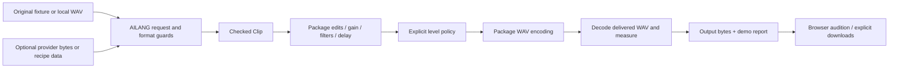

# Audio Tools: checked audio processing and AI-output workbench

Status: proposed design, 2026-10-26. The dependency
[sunholo/audio@0.4.0](https://github.com/sunholo-data/ailang-packages/releases/tag/audio-v0.4.0)
is merged and registry-published. A fresh registry-only consumer passes on the
interpreter and strict VM with runtime contracts. This document does not implement
or deploy the demo.

## Outcome

Add an **Audio Tools** demo at `/ailang-demos/audio-tools/`. A visitor can generate
an original fixture or import a small supported WAV, apply a checked processing
chain, compare original/processed playback, inspect measurements and download a
WAV plus its processing report. The offline path needs no key or microphone.
Later, optional AI speech or model-proposed recipes enter the same checked path.

The demo showcases reusable `sunholo/audio` capabilities. Loop Lab remains the
separate instrument/DAW application at
[sunholo-data/ailang-loop-lab](https://github.com/sunholo-data/ailang-loop-lab).
Link to it as a larger consumer; do not copy its four-track application, Python
server, session planner or worklet implementation into this repo.

Success means a clean clone builds a self-contained public artifact, browser
processing actually invokes AILANG, and exported audio matches the CLI reference.
A working JavaScript effects UI alone does not meet the repo's demo requirement.

## Audited repository baseline

Reviewed demos main at `3e2a45688b0a30ac4830367162c70f2992123281`:

| Existing component | Consequence for this design |
|---|---|
| `CLAUDE.md`: CLI `.ail` modules are primary; browser demos must exercise AILANG | Implement and test the AILANG host before the UI; JavaScript owns browser transport/playback |
| Root `.ailang-version` is v0.35.2 | Do not use that runtime for audio 0.4.0 or silently upgrade all demos |
| `decisions/.ailang-version` and `scripts/build-decisions.sh` | Follow its isolated, pinned runtime/artifact pattern, with a dedicated audio dependency lock |
| `decisions/site/worker.js` loads package/host modules and calls AILANG in a worker | Reuse the worker/module-loading pattern, subject to the bulk-audio bridge spike below |
| `scripts/vendor-wasm-packages.sh` reads the root lock and warns/continues on cache misses | Add an audio-specific build that reads its own lock and fails on a missing dependency; do not rely on the root vendor script unchanged |
| `.github/workflows/deploy-invoice-processor.yml` assembles `_site/` and deploys Pages | Add a tested audio artifact as a required build dependency, then copy that exact artifact into `_site/audio-tools/` |
| `scripts/smoke/smoke.mjs` uses `__demoReady` / `__demoError` | Add a real worker-init and fixture-processing readiness check, not a decorative ready flag |
| `streaming/shared/audio-worklet.js` has nearest-sample capture resampling and its own PCM convention | Do not reuse it as a package codec/resampling reference; microphone/streaming integration is later work |

AILANG v0.54.18 publishes `ailang-wasm.tar.gz` and checksum assets. Availability
of that archive is confirmed; loading the complete audio graph and efficiently
bridging its bytes/arrays in that runtime still need executed browser evidence.

## Scope and ownership

| Owner | Responsibilities |
|---|---|
| `sunholo/audio@0.4.0` | Checked clips, PCM16/WAV import/export, recipes, edits, levels, filters, delay and gain ramps |
| `std/audio` / AILANG core | Shared codecs/numeric runtime; report reproduced missing browser primitives upstream |
| `audio_tools/*.ail` | Demo request parsing, bounded composition of package calls, presentation/report schema and CLI entries |
| Browser worker | Run AILANG off the main thread; job ownership, cancellation, byte transport and progress between operations |
| Browser page | Controls, waveform display, audio playback, local file selection and explicit downloads |
| Optional provider adapter | One user-triggered generation request, provider format/auth, response byte limits and cancellation |
| Loop Lab repo | Musical transport, recording/privacy, arrangement, projects, instruments, DAW/native/plugin integration |

MVP excludes microphone capture, streaming AI sessions, live DSP callbacks, VST/AU
hosting, MIDI, compressed-input decode, arbitrary sample-rate conversion and
multichannel layouts beyond stereo. Those are not implied by an effects demo.

## First visitor flow

1. Open **Audio Tools** from a new hub card. Load a small original fixture by
   default; do not autoplay or request microphone permission.
2. Choose **Make a sound** (checked recipe presets: tone, noise/percussion,
   stereo polarity test) or **Open WAV** (supported integer PCM16 mono/stereo).
   Show source rate, channels, frames and duration before processing.
3. Choose an ordered, bounded chain: gain ramp/fade, low-pass or high-pass,
   feedback delay, then optional Off / PeakSafe / MatchRms preparation. Start
   with one preset chain; advanced controls expose the same typed parameters.
4. Press **Prepare audio**. Keep the original immutable. Show progress and Stop;
   a failed/cancelled/stale job cannot replace the last successful result.
5. Explicitly play **Original** or **Processed** with a visible conservative
   playback gain. Both comparisons use the same playback setting. That audition
   attenuation is separate from exported sample levels and report measurements.
6. Inspect input/output sample peak, RMS/activity policy, gain decision, settings,
   rate/layout/frame counts, truncation/tail policy and output identity.
7. **Download WAV** exports the active processed bytes. **Download report** saves
   bounded metadata. No recording, prompt or key is automatically uploaded/saved.

Use the existing AILANG logo, Montserrat and Sunholo slate/orange tokens, with the
demo hub's navigation and responsive layout. Reuse checked-in licensed branding
assets rather than creating a separate visual identity. Controls need labels,
keyboard operation, visible errors and text equivalents for waveform/level charts.

## Published dependency identity

- Package: exact registry `sunholo/audio@0.4.0`.
- Source: `32274caebee029ba3fb8f6a3f70d7113a1bec24b` (merged PR #165).
- Content: `sha256:67c03510f1402ff908b8a84c872e8bc6b508e6f5cbbab55f06382bcd613655f5`.
- Interface v2: `sha256:ifacev2:106fa417c34c705e7c7069c8872d9cc76c5f46e2fea170ad0762cd06a205acca`.
- Tested native CLI: v0.54.18. Dedicated browser runtime starts from that same
  release and must pass M0 rather than assuming native results transfer to WASM.

## Processing architecture



All DSP and canonical codec/measurement decisions call the registry package.
JavaScript must not substitute its own effects, normalize samples or encode a
different WAV when AILANG fails. Web Audio may convert a supplied AudioBuffer for
device playback; that does not change the downloaded artifact or establish a
package resampler. Report sample-domain results separately from device behavior.

Keep delay/gain/filter states inside one AILANG processing job, retaining state
between bounded blocks. Do not serialize the whole delay history over the worker
boundary for every block. Keep frame positions absolute so partitions preserve
gain ramp and delay results. A new job starts from the original source, preventing
compounded level changes. Append caller-selected silence to render delay tails;
include those frames in output budgets and report when the tail is truncated.

### Required CLI/WASM bridge spike

Before the browser UI, prove all of the following with the pinned artifact:

- Resolve exact registry audio 0.4.0 without a sibling checkout; load all required
  transitive `.ail` modules in dependency order through the actual WASM API.
- Import a bounded PCM16/WAV fixture, run gain/filter/delay/levels, and return the
  encoded bytes plus a small JSON report. Test bytes/Array/Result conversions;
  do not assume a CLI string wrapper is an efficient bulk-audio bridge.
- Compare exported WAV bytes and decoded measurements with interpreter and strict
  VM fixtures, including stereo, negative zero where relevant, and codec rounding.
- Measure startup, memory, preparation and cancellation at the proposed size caps.
  Test the baseline in Chromium and a manual Firefox run before claiming support.
- Verify package guards execute in ordinary WASM calls. Record whether optional
  runtime contracts are supported/enabled; never label them as executed by inference.

The existing worker exposes `ailangLoadModule` / `ailangCallAsync`. The exact
bulk payload convention is settled by this spike, not by inventing a new core API
in this design. Prefer transferable byte buffers when supported. A base64/JSON
bridge is acceptable only after size/copy overhead is measured and bounded.

If a core primitive is missing, keep the CLI demo usable and send a minimal
reproduction through AILANG messages. Do not ship a JavaScript-only DSP fallback
or rely on a private Studio relay for the public page.

### Initial budgets (implementation proposals)

| Resource | Proposed first cap |
|---|---|
| Source WAV | 2 MiB before decode; supported integer PCM16 mono/stereo only |
| Input rate | 8, 16, 24, 44.1 or 48 kHz; preserve declared source rate |
| Input plus explicit tail | At most 10 s and 480,000 frames; at most 960,000 channel samples |
| Initial fixture/default job | 2 s mono; do not start with the largest allowed input |
| Processing blocks | 4,096 frames / 8,192 samples, cumulative frames bounded by total output cap |
| Delay history | At most min(96,000, 2*rate) frames and 192,000 channel samples |
| Recipe | 16 KiB UTF-8 JSON, 8 layers, same output cap and explicit layer-work budget |
| Chain | At most 8 typed operations; reject unknown kinds and invalid parameters |
| Worker requests | One active job, at most one replacement request; monotonically increasing job IDs |
| Processing watchdog | Initial 30 s wall-clock deadline, then terminate/reinitialize the worker; validate this threshold on target browsers |
| Startup watchdog | Initial 120 s, progress and a retryable failure state; never silently report ready |

Validate metadata before sample allocation. A selected source file already occupies
browser memory; these limits do not bound total heap, Go GC or network response
allocation. The bridge spike may lower caps; raising them requires fresh evidence.
No package effect budget measures pure sample operations or guarantees a callback.

## Demo request/report boundary

Use a versioned demo envelope (`audio-tools-request/v1`) with an allowed source
kind, validated format metadata, a closed operation list, level policy and explicit
tail frames. Separate bulk bytes from small control metadata. Unknown fields that
affect processing, unsupported formats and resource overflow return typed errors.
Never accept model-authored AILANG/JavaScript for execution.

Use a **demo-local** `audio-tools-report/v1` until the package has a shared typed
AudioReport API. It is presentation/composition metadata, not a new generic DSP
implementation. Preserve a migration/version policy when shared reports arrive.

The report includes package/runtime versions and source hashes, source kind,
format/rate/layout, input/output frames, ordered processor settings, explicit
tail/quantization policy, level configuration/decision, prepared float levels,
decoded delivered-WAV levels, byte count/hash, and observed worker timing.
Hash original and output bytes where available; do not present a PCM hash as a
hash of the imported WAV container. Do not include keys, local paths, device IDs,
raw samples, prompts or whole provider responses by default.

Show separate evidence labels:

- **Guards:** which checked import/processing/export boundaries ran successfully.
- **Measurements:** delivered sample peak/RMS and byte identity, not LUFS,
  true-peak, perceived quality or physical latency.
- **Tests:** fixture/native/browser checks with runtime/version provenance.
- **Proofs:** link the version-specific package result; audio 0.4.0 was measured
  at 16/71 contracts verified, 55 skipped, zero refutations/errors on v0.54.18.
  The new public effect APIs are not SMT-proved; the integer cursor/ramp helpers are.

There is no blanket “verified audio” flag. A provider returning finite valid PCM
does not establish that generated speech/music has the intended meaning.

## Optional AI input, after the offline artifact works

Two future entry paths share the same checked processing/export pipeline:

1. **Generate speech:** explicit one-shot request through a small adapter for the
   repo's configured speech provider. CLI uses `std/ai.callSpeech` where its fixed
   PCM contract fits; browser transport must preserve the tested provider format.
   Model/voice and supported MIME formats are checked at implementation time.
2. **Describe a sound:** ask a model for data matching the existing recipe schema;
   validate it with `parseRecipesChecked`, render under bounds, then process it.
   No arbitrary code or unconstrained processor graph is executed.

Start with one provider adapter, not a provider marketplace. Default fixtures
remain available with no account. Browser requests go directly to the disclosed
provider if its CORS/auth contract is tested; never embed an operator key in Pages.
If a server-only provider is chosen later, design that authenticated service
separately rather than sending a visitor key to an undocumented relay.

Follow `CLAUDE.md`'s established `<provider>-api-key` storage convention if the
user elects to remember a key, with a visible clear action. Do not invent a
demo-specific key name. Keys never enter processing reports, source modules,
URLs, logs or downloadable assets. Make any text/audio upload and cost explicit
before the user starts generation. A selected local WAV stays local unless an
explicit provider-input action is added and approved by the visitor.

Allow one generation request in flight, no automatic retries, bounded input text
and response bytes, explicit timeout/cancel and a visible usage/unknown-cost state.
Dollar caps must use documented provider usage data; do not invent prices or claim
a client-side threshold is an account billing limit. Generation request effects and
budgets are distinct from pure DSP budgets. Offline CI uses fake responses; real
CORS/auth/model-output acceptance is a separately reported manual/opt-in check.

## Proposed layout and reproducible artifact

```text
audio_tools/
  DESIGN_SPEC.md          # this document
  .ailang-version         # exact tested CLI/WASM release, initially v0.54.18
  ailang.toml             # independent demo application; audio = "0.4.0"
  ailang.lock             # portable registry lock, never a developer path
  main.ail                # CLI fixture/import/process/report entries
  host.ail                # checked request → package composition → result
  report.ail              # demo report projection/JSON encoding
  *_test.ail              # native negative/partition/reference tests
  fixtures/               # tiny original fixtures and pinned identities
  site/                   # page, worker, controls, playback, licensed branding
  test/                   # WASM, browser, cancellation/export and artifact tests
scripts/build-audio-tools.sh
```

Build into a fresh destination from the demo's lock, enforcing source=`registry`
and expected content/interface identities. Copy the required package sources into
the static output during the build; this is a generated dependency artifact, not
a second hand-maintained DSP source tree. Include licenses and provenance. Fetch
the exact WASM/runtime pair, verify a pinned archive hash, and emit build metadata.
Do not use “latest”, root-cache miss warnings, absolute checkout paths, shared
runtime symlinks or a local core checkout as public build requirements.

The source release of Loop Lab remains independent. No Loop Lab registry package
or iframe/private preview is a dependency of Audio Tools.
Audio Tools itself is a demo application/site source release, not a new AILANG
registry library. Reusable processing changes go into sunholo/audio first.

## CI and deployment changes at implementation time

Add a `test-audio-tools` job that installs the demo's pinned CLI/Z3, resolves and
checks its lock, compiles/tests the demo, executes runtime-contract probes and
runs package quality. On the measured v0.54.18, `pkg quality` executes tests and
smoke and invokes Z3; older prose in this repo saying it only inventories source
is stale. Report individual sections, skips and warnings; do not silently disable
strict checks to hide a known inherited warning.

Build one static artifact and test that artifact in Node/WASM and browser tests.
Use the package's independent Python WAV reference and explicit known outputs;
parity between two copies of the same bug is insufficient. Upload the tested
artifact, quality results and pinned identity metadata.

Extend Pages workflow path filters for `audio_tools/**` and the builder script.
Make deployment depend on the audio test job and download its exact artifact into
`_site/audio-tools/`. Add the card in `site/index.html`, source link in README,
the local preview build/copy in `scripts/serve.sh`, and a smoke entry for the new
route. Run its dedicated pinned CLI job rather than forcing new source through
the root v0.35.2 check script/runtime. Preserve other demo routes and versions.

`window.__demoReady` is set only after worker initialization and a tiny checked
fixture round-trip; `__demoError` identifies boot failure without private data.
Test both `/audio-tools/` locally and the `/ailang-demos/` deployment base path.
All required module URLs must exist in a clean static artifact.

## Validation and milestones

| Milestone | Concrete acceptance |
|---|---|
| M0 — canonical processing + WASM spike | CLI fixture/import pipeline, native guards/properties, exact dependency/runtime pins; actual WASM graph and byte bridge round-trip; measured limits/cancel behavior |
| M1 — offline public workbench | Fixture + PCM16 WAV import, ordered effects, equal-setting A/B audition, delivered measurements, correct WAV/report download; no key/mic; exact artifact passes browser CI before Pages deploy |
| M2 — optional AI inputs | One provider adapter, explicit action/cost/upload boundary, fake-provider CI and separate real-provider acceptance; generated PCM/recipe uses M1 processing |
| M3 — consumer handoff | Link/export workflow for Loop Lab/Live; any shared generic report or processing improvements land in sunholo/audio first |

Tests include mono/stereo and opposite polarity, byte pins, malformed/truncated
WAVs, unsupported layouts/depths, extreme/nonfinite settings, oversized inputs,
block partitions, tail caps, silence/no-boost behavior, stale worker results,
Stop/reset/retry, repeated playback and object-URL cleanup. A failure must retain
the previous successful result without exporting partially prepared data.

Browser checks cover worker/module startup, actual fixture processing, valid and
invalid file selection, UI limits, no autoplay/microphone prompt, original versus
processed identity, download bytes, responsive/keyboard behavior, cancellation and
deployment-path resolution. Capture preparation timing and memory observations
separately from physical/audio-device claims. No new 30-minute soak is required
for an offline tools page, and Loop Lab's historical soak is not inherited proof.

## Open implementation decisions

- Which supported WASM bulk-byte convention is fast enough at the initial caps?
  Resolve in M0; escalate a reproduced missing primitive upstream if necessary.
- Which single speech/model adapter has a tested browser transport? Choose before
  M2 and document its supported format/usage reporting; no provider choice blocks M1.
- Can a future shared package AudioReport replace the demo projection cleanly?
  Keep v1 explicitly local and avoid promising a package API that does not exist.

These are implementation gates with a working offline route, not reasons to
couple the library to one provider, a DAW or a browser runtime.
